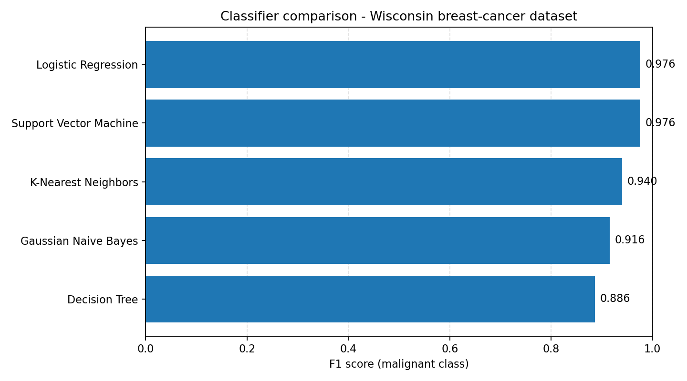

# Supervised Learning Algorithm Comparison

A reproducible comparison of five supervised classification algorithms using the Wisconsin Diagnostic Breast Cancer dataset bundled with scikit-learn. The script prints a ranked metrics table and writes a CSV and chart to `outputs/`.

## Run

```bash
python -m pip install -r requirements.txt
python compare_models.py
```

No separate dataset download is required. The source dataset has 569 samples, 30 numeric measurements, and two classes (malignant and benign). The same stratified 80/20 train/test split (random state 42) is used for every model. Median imputation is fitted inside each training pipeline; this dataset has no missing values. There are no categorical input columns, so one-hot encoding is configured for categorical features but is not needed for this dataset. Standard scaling is applied to Logistic Regression, K-Nearest Neighbors, and the RBF Support Vector Machine, but not to the Decision Tree or Gaussian Naive Bayes.

## Results

Ranked by malignant-class F1 score on the held-out test set. Precision and recall also refer to the malignant class; accuracy covers both classes.

| Rank | Model | Accuracy | Malignant precision | Malignant recall | Malignant F1 |
|---:|---|---:|---:|---:|---:|
| 1 (tie) | Logistic Regression | 0.982 | 0.976 | 0.976 | 0.976 |
| 1 (tie) | Support Vector Machine (RBF) | 0.982 | 0.976 | 0.976 | 0.976 |
| 3 | K-Nearest Neighbors | 0.956 | 0.951 | 0.929 | 0.940 |
| 4 | Gaussian Naive Bayes | 0.939 | 0.927 | 0.905 | 0.916 |
| 5 | Decision Tree | 0.912 | 0.848 | 0.929 | 0.886 |



The full-precision values are in [`outputs/model_comparison.csv`](outputs/model_comparison.csv). Re-run `python compare_models.py` to reproduce the table and chart.

## Interpretation

Logistic Regression and the RBF Support Vector Machine tie for the best malignant-class F1 (0.976) and accuracy (0.982) on this split. The dataset's measurements contain strong signal for distinguishing malignant from benign tumors; a linear decision boundary is already effective, while the RBF SVM can also capture smooth nonlinear patterns. Scaling keeps large-magnitude measurements from dominating either model. Their identical rounded test metrics do not mean their decision boundaries are the same.

The unpruned Decision Tree has the lowest malignant-class F1 (0.886) and accuracy (0.912). Its malignant recall (0.929) is relatively high, but its lower precision (0.848) means it labels more benign tumors as malignant than the top models do. A single unrestricted tree can make brittle, overly specific splits and generalize less well to unseen samples. Gaussian Naive Bayes also trails the leading models, consistent with its conditional-independence assumption being a poor fit for correlated measurements such as radius, perimeter, and area. F1 balances malignant precision and recall, making it a useful comparison metric here, but it does not replace clinical validation.

## Dataset citation

Wolberg, W. H., Street, W. N., & Mangasarian, O. L. (1995). *Breast Cancer Wisconsin (Diagnostic)*. UCI Machine Learning Repository. https://doi.org/10.24432/C5DW2B. The scikit-learn copy is available through `sklearn.datasets.load_breast_cancer`.
